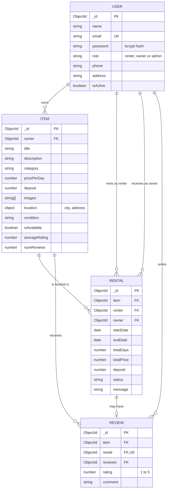
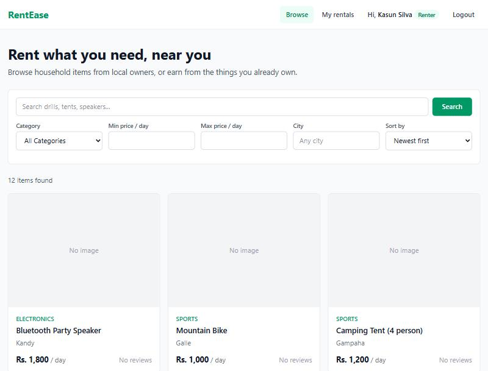
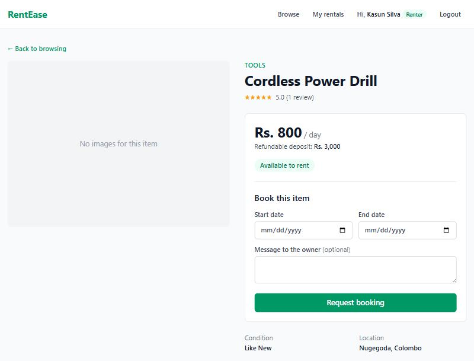
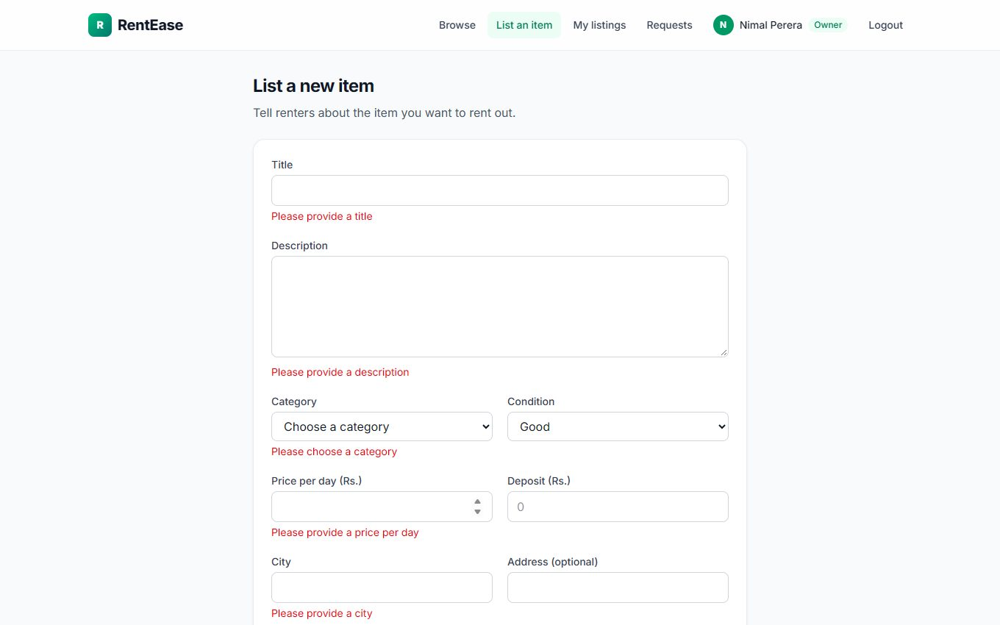
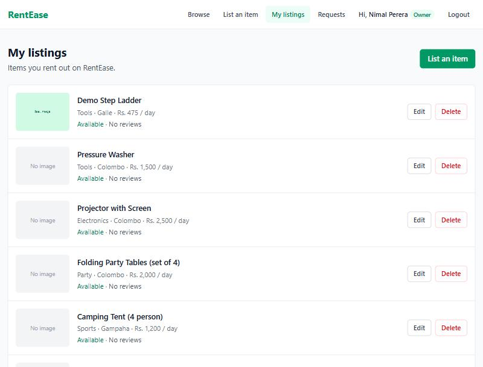
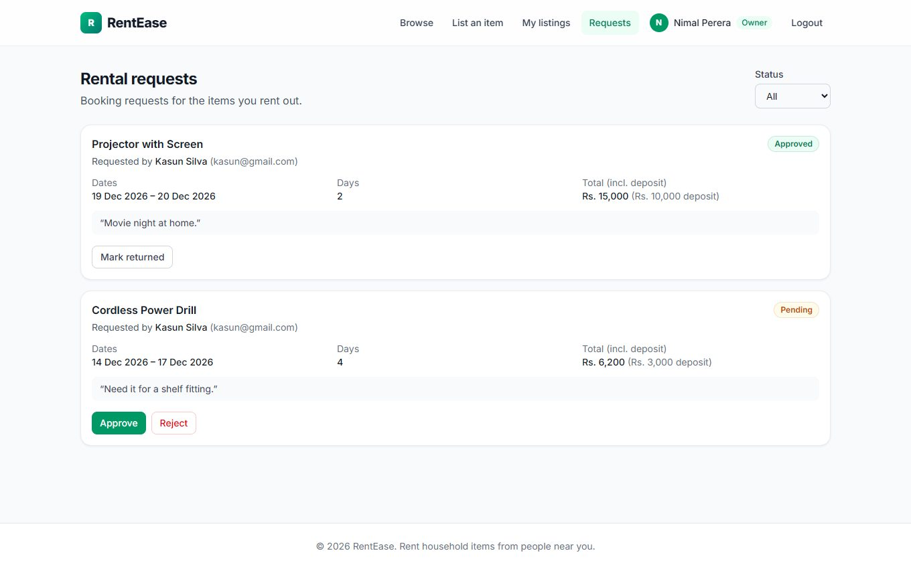
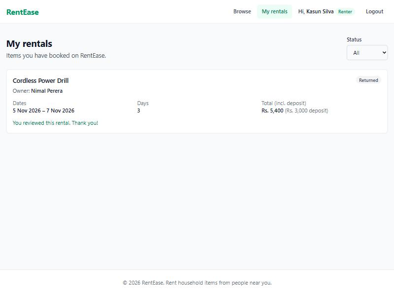
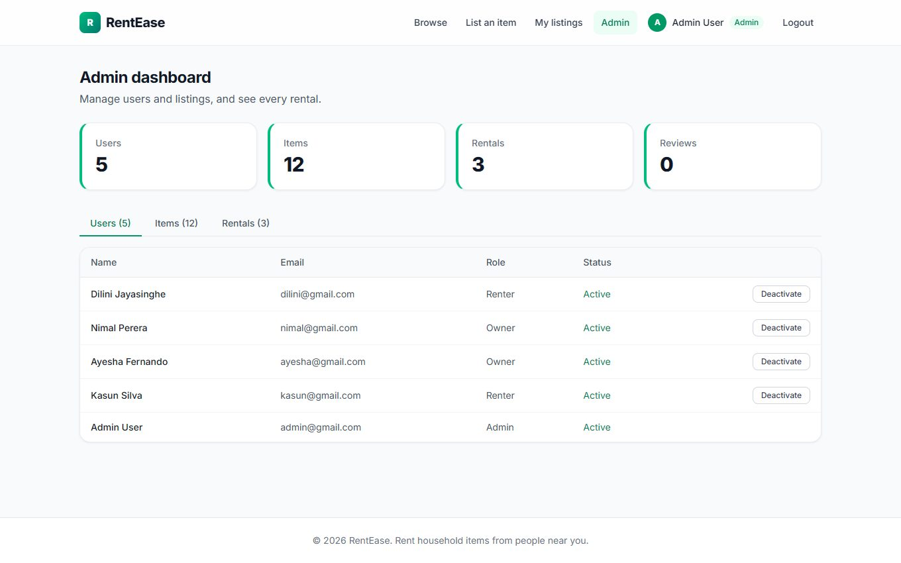
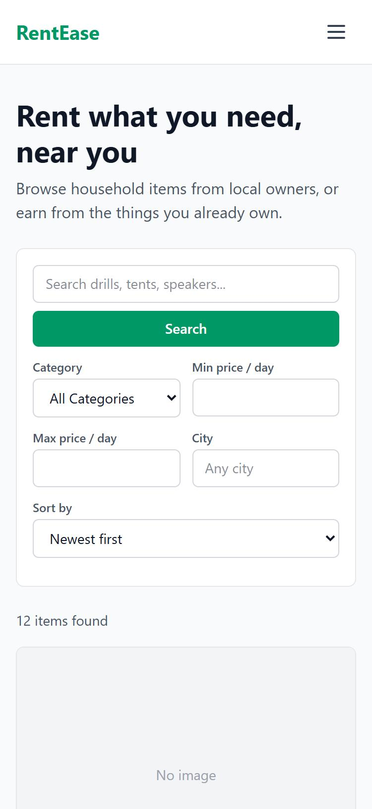

# RentEase

RentEase is a household item rental marketplace built with the MERN stack.
Owners list items such as tools, party equipment and appliances. Renters search
for items, book them for a date range and review them after returning them.

## Features

- **Accounts and roles:** register and log in as a renter or owner with JWT
  authentication. Admin accounts are created only by the seed script.
- **Item management (CRUD):** owners create, view, edit and delete listings with
  up to 5 images each.
- **Browsing:** keyword search, filters for category, price and city, sorting
  and pagination.
- **Bookings:** date-range booking with overlap checks and a price calculated on
  the server. Owners approve, reject or mark rentals returned. Renters can cancel.
- **Reviews:** renters rate an item after a returned rental, once per rental. The
  item's average rating updates automatically.
- **Admin dashboard:** summary counts, activate or deactivate users, remove
  listings and view every rental.
- **Validation and errors:** checks on both client and server, field-level error
  messages and a central error handler.
- **Security:** hashed passwords, security headers (helmet), a CORS whitelist and
  rate limiting on the auth endpoints.

## Tech stack

| Layer | Technology |
|---|---|
| Client | React 18, Vite, React Router, Axios, Tailwind CSS |
| Server | Node.js, Express 4, express-validator, multer, JSON Web Tokens |
| Database | MongoDB with Mongoose |
| Tests | Jest, Supertest, mongodb-memory-server |

## Project structure

```text
rentease/
├── client/               React app
│   └── src/
│       ├── api/          Axios instance
│       ├── components/   Shared UI (navbar, forms, badges)
│       ├── context/      Auth and toast state
│       ├── pages/        One component per route
│       └── utils/        Formatting helpers and constants
├── server/               Express API
│   ├── config/           Database connection
│   ├── controllers/      Request handlers
│   ├── middleware/       Auth, validation, uploads, errors
│   ├── models/           Mongoose schemas
│   ├── routes/           Endpoint definitions
│   ├── tests/            API tests
│   ├── utils/            Seed script and helpers
│   └── validators/       express-validator rules
└── render.yaml           API deployment config
```

## Setup

You need [Node.js](https://nodejs.org) 18 or newer and MongoDB running locally.

**1. Clone the repository**

```bash
git clone https://github.com/Supasan17/rentease.git
```

```bash
cd rentease
```

**2. Start the API**

```bash
cd server
```

```bash
npm install
```

Copy `.env.example` to `.env` and set `JWT_SECRET` to a long random string.

```bash
npm run seed
```

```bash
npm run dev
```

The API runs at `http://localhost:5000`. **`npm run seed` deletes everything in
the configured database first**, so only run it on a local development database.

**3. Start the client** (in a second terminal, from the project root)

```bash
cd client
```

```bash
npm install
```

Copy `.env.example` to `.env`.

```bash
npm run dev
```

Open `http://localhost:5173`.

### Sample accounts

These are created by the seed script. All use the password `password123`.

| Role | Email |
|---|---|
| Admin | `admin@gmail.com` |
| Owner | `nimal@gmail.com` |
| Owner | `ayesha@gmail.com` |
| Renter | `kasun@gmail.com` |
| Renter | `dilini@gmail.com` |

### Environment variables

| Variable | Where | Purpose |
|---|---|---|
| `PORT` | server | API port (default 5000) |
| `MONGO_URI` | server | MongoDB connection string |
| `JWT_SECRET` | server | Secret for signing login tokens |
| `CLIENT_URL` | server | Client origins allowed by CORS, comma separated |
| `NODE_ENV` | server | `development` shows error stack traces in responses |
| `VITE_API_URL` | client | Base URL of the API |

Production examples are in `server/.env.production.example` and
`client/.env.production.example`.

## Tests

```bash
cd server
```

```bash
npm test
```

The 26 API tests cover auth, item CRUD, search, bookings and reviews. They use an
in-memory database and do not touch your development data.

## Database design



**Rental statuses:** a rental starts as `pending`. The owner moves it to `approved`
or `rejected`, and later marks an approved rental `returned`. The renter can move
a `pending` or `approved` rental to `cancelled`.

## API reference

All endpoints start with `/api`. Private routes need the header
`Authorization: Bearer <token>`.

### Auth

| Method | Endpoint | Access | Purpose |
|---|---|---|---|
| POST | `/auth/register` | Public | Create an account |
| POST | `/auth/login` | Public | Log in and get a token |
| GET | `/auth/me` | Private | Get your profile |
| PUT | `/auth/me` | Private | Update your profile or password |

### Items

| Method | Endpoint | Access | Purpose |
|---|---|---|---|
| GET | `/items` | Public | List items (`search`, `category`, `minPrice`, `maxPrice`, `city`, `sort`, `page`, `limit`) |
| GET | `/items/mine` | Owner, admin | List your own items |
| GET | `/items/:id` | Public | Get one item |
| GET | `/items/:id/reviews` | Public | List an item's reviews |
| POST | `/items` | Owner, admin | Create an item (multipart, field `images`) |
| PUT | `/items/:id` | Item owner, admin | Update an item |
| DELETE | `/items/:id` | Item owner, admin | Delete an item with no open rentals |

### Rentals

| Method | Endpoint | Access | Purpose |
|---|---|---|---|
| POST | `/rentals` | Renter | Request a booking |
| GET | `/rentals/my` | Renter | List your bookings |
| GET | `/rentals/requests` | Owner | List requests for your items |
| GET | `/rentals/:id` | Renter, owner, admin | Get one rental |
| PATCH | `/rentals/:id/approve` | Rental owner | Approve a pending rental |
| PATCH | `/rentals/:id/reject` | Rental owner | Reject a pending rental |
| PATCH | `/rentals/:id/return` | Rental owner | Mark a rental returned |
| PATCH | `/rentals/:id/cancel` | Rental renter | Cancel a rental |

### Reviews

| Method | Endpoint | Access | Purpose |
|---|---|---|---|
| POST | `/reviews` | Rental renter | Review a returned rental |

### Admin

| Method | Endpoint | Access | Purpose |
|---|---|---|---|
| GET | `/admin/stats` | Admin | Summary counts |
| GET | `/admin/users` | Admin | List users |
| PATCH | `/admin/users/:id/status` | Admin | Activate or deactivate a user |
| GET | `/admin/items` | Admin | List all items |
| DELETE | `/admin/items/:id` | Admin | Delete an item |
| GET | `/admin/rentals` | Admin | List all rentals |

## Screenshots

**Browse items**



**Item details and booking**



**Create item form with validation**



**My listings (owner)**



**Rental requests (owner)**



**My rentals (renter)**



**Admin dashboard**



**Mobile view**



## Deployment

- **API:** `render.yaml` defines a Render web service. Set `MONGO_URI` (for example
  MongoDB Atlas) and `CLIENT_URL` in the dashboard.
- **Client:** deploy `client/` to Vercel and set `VITE_API_URL`. `client/vercel.json`
  sends every route to the React app.

Uploaded images are stored on the server's disk, so hosts with a temporary
filesystem lose them when the service restarts.
